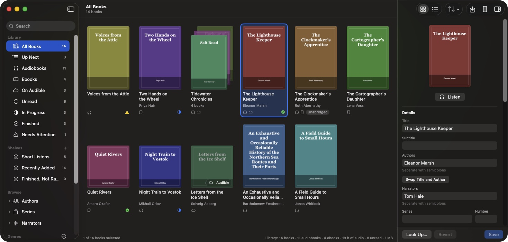
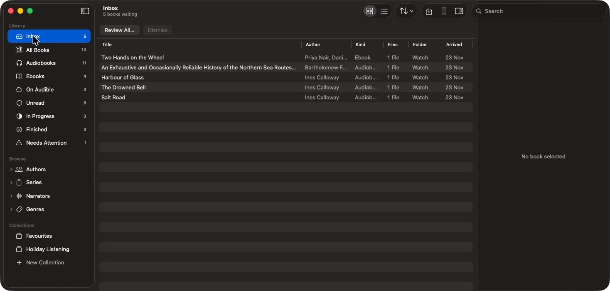
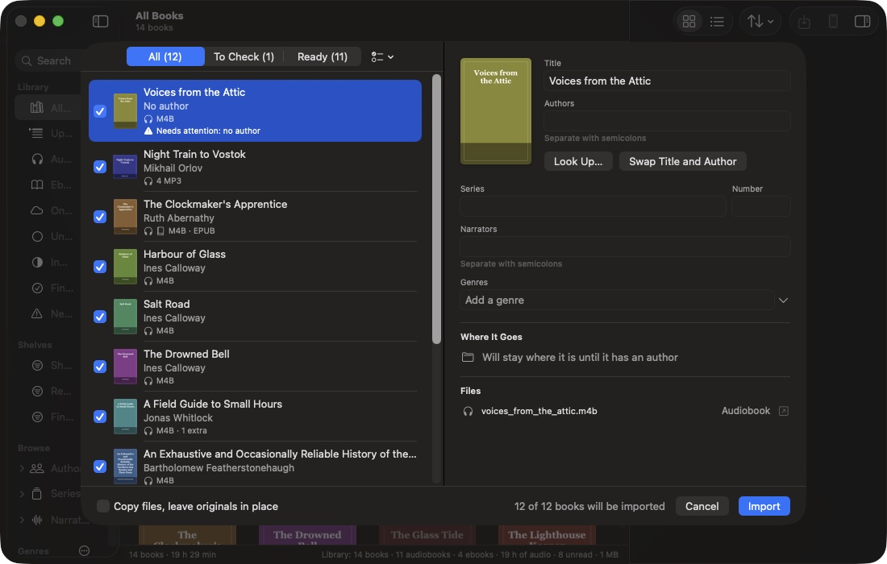
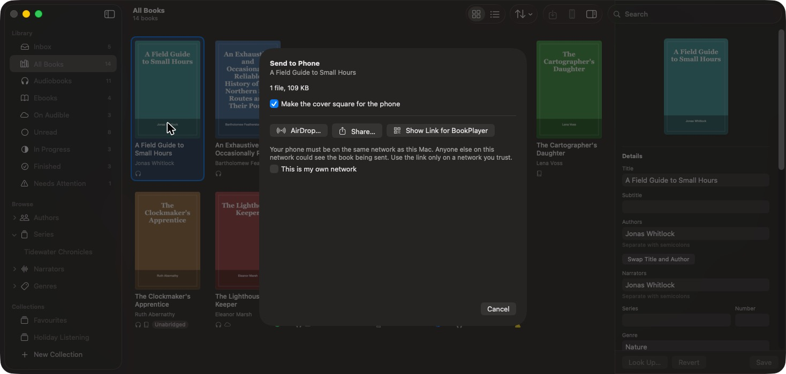

# VoxCarrel

A native Mac app for managing a personal library of audiobooks and ebooks: a modern replacement for Calibre that treats audiobooks and ebooks as equals, with one entry per book whatever forms you own it in.

VoxCarrel files your books into a tidy folder layout, writes details and covers into the files themselves, and looks books up online. It manages files you already own; it is not a store or a downloader.

**Status:** early. It has a large automated test suite, run on generated sample books, and has been used on a small real collection, not yet a large one. You build it from source for now. Import by copy until you trust it with yours.



| | |
|---|---|
|  |  |
| The same library as a list, with a series opened. | A series in order: three books on this Mac, the fourth on Audible. |
|  |  |
| Books that arrive in a watched folder wait in the Inbox. | Nothing moves until you have reviewed it. |
|  |  |
| Entries that are one book can be merged, with a role for each file. | An audiobook can be sent to your phone. |

The books in these pictures are generated samples from the demo library.

## At a glance

- **One entry per book.** The audiobook, the ebook, a companion PDF, and "I own this on Audible" or "on Kindle" are one book, not four.
- **Your files, kept tidy.** Books are filed into folders arranged the way you choose, with details and covers written into the files themselves.
- **Nothing moves until you have reviewed it.** Every import goes through a review sheet, and the last operation can be undone.
- **Everything you own, in one list.** Your files, your Audible library and your Kindle library, side by side.
- **Your highlights, on the books.** From Readwise, from marks made while listening on Audible, and your own.
- **What to read next.** Up Next, smart shelves, and series that show what is missing.
- **Local and private.** The library is a folder and a database on your Mac. Nothing is sent anywhere until you ask.

## What it does

### Bringing books in

- **Import** audiobooks (M4B, M4A, MP3, including a folder of parts as one book) and ebooks (EPUB, PDF), by move or copy, through a review sheet. MOBI, AZW3, AZW, PRC, DjVu, FB2, LIT and CHM are filed but never opened or modified.
- **A messy folder is read sensibly.** Copies are set aside, the same book in several formats is one entry, and an audiobook kept in disc folders is one book.
- **A calibre library comes across in one step.** Its books are copied in with their details, series, covers, tags, ratings and dates. The calibre library is left exactly as it was.
- **Watch folders**, such as Downloads: books that arrive wait in an Inbox, and are filed only when you review them.
- **Books you own elsewhere.** Link your Audible account to list every book you own there, and your Kindle library with the same link. They appear as entries marked "on Audible" or "on Kindle"; books you already have are marked, not added twice.

<details>
<summary>More about importing</summary>

- A file is known as a copy by its sound or its text, whatever its tags say, including a copy of a book the library already has.
- When a file's tags say too little, its name is read (either way round, with an Audible ID if the name has one). The review says what was guessed, and asks before adding files to a book that only might be the same one.
- Titles a program left in a PDF ("Microsoft Word - draft.doc") are passed over for the file's name.
- The details and cover calibre keeps beside a book are used even in an ordinary folder import.
- Files still in iCloud are not fetched until you import.
- Two entries of the same book in a calibre library come in as one.
- The Kindle list is read from Amazon's Kindle web reader, which is not an official interface and could stop working. Nothing is changed at Amazon and no Kindle file is touched.

</details>

### Keeping them in order

- **Folders your way:** `Author/Series/Title` to begin with, or another layout or a pattern of your own. Changing it shows what will move, then re-files the whole library in one step.
- **Merge** entries that are really one book (an audiobook, its ebook and a companion PDF imported separately).
- **Genres from a short list** you can rename, merge and add to. Whatever a file or a lookup says is mapped onto it.
- **Read status, tags, ratings and collections.**
- **Hide books** you choose: they leave every list, count and search, and come back into view only after Touch ID or your Mac's password.
- **A check of the library at launch**, and **undo** for the last operation.

<details>
<summary>More about organising</summary>

- Update files writes the library's genres into the files' tags when you ask, after showing what will change. Fill in Genres looks up the books that have none and shows what it found before anything is applied.
- Hiding keeps books out of sight in the app. Their files stay in the library folder under their own names.
- A status bar under the list shows how many books are listed or selected and how long they run, and the library's totals (books, audiobooks, ebooks, hours of audio, unread, size on disk).

</details>

### Details and covers

- **Edit details and covers** for one book or many. They are written into the files, and checked before they replace the originals.
- **Look books up** on Open Library, the Audible catalogue (several countries' stores at once) and, if you turn it on, the Library of Congress. You choose which fields to take, from one result or several.
- **Editions are told apart:** results that are your exact edition are marked, and an audiobook is recognised as unabridged, abridged or a dramatisation.
- **Convert to EPUB:** for a book whose ebook is MOBI, AZW3 or another older format, an EPUB is made and added beside the original, which is left as it is. This uses calibre's own converter, so it needs calibre installed.
- **MP3 lengths are measured,** and a header that states the wrong length can be repaired so the file plays in full everywhere.

### Series and what to read next

- **Series in order,** grouped as one row in the list or a stack of covers in the grid.
- **A series from everything you own:** files on this Mac, books on Audible and books on Kindle all count towards it, so a series shows complete however you own its books.
- **What is missing:** a series is checked against Audible's own list of it, and the books you do not have are shown in their place.
- **Up Next:** what you are reading, the next book of each series you have begun, whether you own it or not, and books you add yourself.
- **Smart shelves:** sets of conditions you save (unread audiobooks under six hours, say), worked out fresh each time you look.

### Highlights

- **On the book they belong to:** brought in from Readwise (which holds Kindle highlights), from the marks you make while listening on Audible, and your own, added to any book.
- **Search** finds books by the words of their highlights.
- **Kept once:** the same highlight arriving from two places is one highlight. Looking again brings in only what changed.
- Books you have highlighted on Kindle and do not have as files are added as entries marked "on Kindle".

### Your phone

- **Send an audiobook to your phone** by AirDrop, or by a QR code that makes [BookPlayer](https://github.com/TortugaPower/BookPlayer) download it from your Mac. A book in several parts goes as one zip.

## What it does not do

- It does not play or read books; opening one hands it to your usual player or reader.
- It does not handle protected files such as Audible downloads (`.aax`, `.aaxc`) or protected Kindle books, and it does not remove protection. Books you own on Audible or Kindle are listed alongside your files instead.
- It does not download books, and it never asks for a password. An Audible account is linked by signing in on Amazon's own page, in your browser.

## What's next

What is planned, roughly in order. This is a direction, not a promise: things move as real libraries show what matters.

**Before the first release**

- Leaving as cleanly as you came: a standard `metadata.opf` written beside each book, as well as the details inside the files, so another library manager can pick the library up.
- Send to Kindle: an ebook from the library to your Kindle.
- A signed download, so the app can be installed without building it, and `brew install --cask voxcarrel`.
- Export Diagnostics in the Help menu: a zip of logs and settings, with no book titles unless you choose to include them, for reporting the odd file that trips the app up. Nothing is sent anywhere by itself.

**After that**

- Kindle highlights without Readwise, from a Kindle's own clippings file.
- A cover made for a book that has none.
- Page and word counts for ebooks.
- Import from an Audiobookshelf server, with its progress and bookmarks.
- A better copy of a book you already have (a higher bitrate, an EPUB where you had a MOBI) offered as a replacement at import.
- Finding books scattered across the Mac and network drives.
- Library health checks and backups of the catalogue.

Ideas and reports from real libraries are welcome in the issues.

## Requirements

macOS 15 or later. Building needs the Swift 6 toolchain (Xcode 16 or later). There is no Xcode project; Xcode can open either `Package.swift` directly.

## Layout

- `VoxCarrelCore/` — the engine: scanning, filing, tags, the catalogue database, online lookup. No user interface.
- `VoxCarrelApp/` — the app: `VoxCarrelAppCore` holds everything the window shows and does (tested without a window); `VoxCarrelUI` holds the SwiftUI views, which contain no logic; `VoxCarrel` is the executable that starts them.

## Build

```bash
VoxCarrelApp/Scripts/build-app.sh
```

This produces `VoxCarrelApp/build/VoxCarrel.app`, a release build signed for this Mac only. Pass `debug` for a debug build.

## Try it on a demo library

Nothing here touches real books. The demo tool generates sample audiobooks and ebooks. Run these from `VoxCarrelApp/`:

```bash
swift run voxcarrel-demo library ~/VoxCarrelDemo/Library
swift run voxcarrel-demo inbox ~/VoxCarrelDemo/Inbox
open build/VoxCarrel.app --args -libraryPath ~/VoxCarrelDemo/Library
```

- `library <folder>` makes a library of sample books already imported. Add `--count 2000` for a large one.
- `inbox <folder>` makes a folder of loose files to drag onto the window.
- `-libraryPath <folder>` opens that library for this launch without changing the remembered one.

## First run on real books

Create a new, empty folder for the library, outside any synced folder such as iCloud Drive: the catalogue database lives in the library folder and should not be synced while in use. Import a handful of books with "Copy files, leave originals in place" ticked, and check the result before importing more.

Book folders are arranged as `Author/Series/Title` unless you choose otherwise in Settings ▸ General ▸ Folder Layout. Changing the layout shows what will move, then re-files the whole library in one step; only folders move, and Edit ▸ Undo puts them back.

Watch folders are set in Settings ▸ Watch Folders. They are watched only while VoxCarrel is open; books that arrived while it was closed appear in the Inbox shortly after it opens.

Editing a book changes nothing until you press Save. Edit ▸ Undo (⌥⌘Z) reverses the last import, save, repair, merge or change of folder layout.

## Tests

```bash
VoxCarrelApp/Scripts/test-all.sh
VoxCarrelApp/Scripts/smoke-launch.sh
```

`test-all.sh` runs both packages' tests as debug and as optimised builds. `smoke-launch.sh` builds the app, opens it on a fresh temporary demo library, checks it stays running, and quits it. Tests never use the outside network: lookup tests run on recorded answers, and the Send to Phone link is tested on this Mac's own loopback address. Everything a test run creates goes into one temporary folder that is removed when the run ends.

## Online lookup and privacy

Nothing is sent anywhere until you press Look Up (or Check Edition, Check Series, or search in Add Audible Book). Then the title, author, narrator, ISBN or Audible ID you search for is sent to the sources that are switched on, and cover images are downloaded from Open Library and Audible.

Check Series sends the Audible IDs, or the titles and authors, of a few books of that series to the Audible stores that are switched on, and then asks for the series' list.

Each source can be switched on or off in Settings ▸ Lookup. A source that is off is never contacted.

- **Open Library** and **Audible** are on by default and use encrypted connections. The Audible catalogue search is an unofficial interface and may change.
- **The Library of Congress** is off by default. Its catalogue search is only offered over an unencrypted connection, so the title, author or ISBN you look up there can be seen on your network. It is the one exception to the app's rule of encrypted connections only.

Send to Phone's link serves only the one book you chose, only to your local network, for at most ten minutes or one download, and it is not encrypted, so use it on a network you trust. Nothing is sent to any outside service.

Linking an Audible account (Settings ▸ General) is the one time VoxCarrel acts for an account, and only when you ask. You sign in on Amazon's own page, in your browser; VoxCarrel never sees your password. Amazon then registers a device with your account, named like "Your name's Audible for iPhone", and VoxCarrel keeps that device's keys on this Mac, where only your account can read them (in the Keychain for a signed build of the app, in a private file under Application Support/VoxCarrel for one you built yourself), nowhere else. With them, Import Audible Library reads the list of books you own, and downloads their covers from Amazon's image servers. It only reads: nothing is bought, changed or removed at Audible. Unlink removes the device from your Amazon account and the keys from the Keychain; you can also remove the device yourself in your Amazon account, under Content & Devices. This is not an official Amazon interface and may stop working if Amazon changes it.

Import Kindle Library uses the same link. Each time you run it, VoxCarrel asks Amazon for a signed-in web session for your account, sends it only to Amazon's Kindle web reader to read the list of books you own, and keeps it nowhere. A web session can do more on an Amazon account than read a list; VoxCarrel uses it for that one address and nothing else. Covers are downloaded from Amazon's image servers.

Import Highlights reads Readwise with an access token you paste in from your Readwise account. The token is kept on this Mac only, and is sent only to Readwise. VoxCarrel only reads from Readwise: nothing is written to it.

Showing hidden books asks macOS to check Touch ID or your Mac's password. VoxCarrel sees only whether the check passed.

## Contributing

Bug reports and ideas are welcome as issues.

Code contributions need a signed [contributor licence agreement](https://gist.github.com/gemglobalventures/b4a6b846ea644b32fcfccd23dd57ee3e). You keep the copyright in your work; the agreement lets Gem Global Ventures Pte Ltd publish it under the AGPL and also under other licences. When you open your first pull request, a check asks you to sign by posting a comment. For anything larger than a small fix, please open an issue first.

## Acknowledgements

VoxCarrel builds on these open-source libraries, each under its own licence:

- [TagLib](https://taglib.org), through the [CXXTagLib](https://github.com/sbooth/CXXTagLib) package, for reading and writing audio tags: LGPL 2.1 or MPL 1.1.
- [GRDB.swift](https://github.com/groue/GRDB.swift) for the catalogue database: MIT.
- [ZIPFoundation](https://github.com/weichsel/ZIPFoundation) for reading and writing EPUB files and for zipping a book in several parts: MIT.

## Support

If VoxCarrel is useful to you, you can support its development:

[](https://ko-fi.com/K7Q12B3BHJ)

## Licence

VoxCarrel is free software, released under the [GNU Affero General Public License, version 3](LICENSE). You may use, study, change and share it; anything built from it must be shared under the same licence, including when it is offered to others over a network.

Copyright © 2026 Gem Global Ventures.
