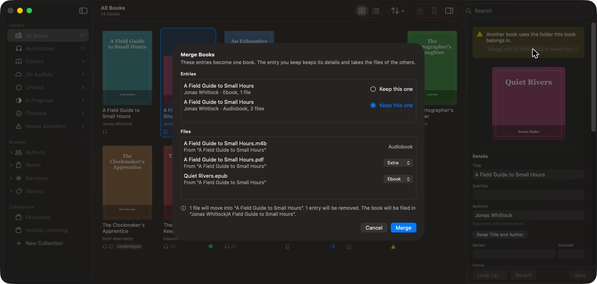

# VoxCarrel

A native Mac app for managing a personal library of audiobooks and ebooks: a modern replacement for Calibre that treats audiobooks and ebooks as equals, with one entry per book whatever forms you own it in.

VoxCarrel files your books into a tidy folder layout, writes details and covers into the files themselves, and looks books up online. It manages files you already own; it is not a store or a downloader.

**Status:** early. It has a large automated test suite, run on generated sample books, and has been used on a small real collection, not yet a large one. Import by copy until you trust it with yours.


| | |
|---|---|
|  |  |
| The same library as a list, with a series opened. | A series in order: three books on this Mac, the fourth on Audible. |
|  |  |
| Books that arrive in a watched folder wait in the Inbox. | Nothing moves until you have reviewed it. |
|  |  |
| Entries that are one book can be merged, with a role for each file. | An audiobook can be sent to your phone. |

The books in these pictures are generated samples from the demo library.

## What it does

**Organising**

- Imports audiobooks (M4B, M4A, MP3, including a folder of parts as one book) and ebooks (EPUB, PDF; MOBI and AZW3 are filed but never modified), by move or copy, through a review sheet.
- Reads a file's name when its tags say too little (either way round, with an Audible ID if the name has one), says in the review what it guessed, and asks before adding files to a book that only might be the same one.
- Keeps an audiobook, its ebook and companion files together as one book, in folders arranged the way you choose: `Author/Series/Title` to begin with, or another layout or a pattern of your own.
- Watches folders you name, such as Downloads: books that arrive are listed in an Inbox, and are filed only when you review them.
- Merges entries that are really one book (an audiobook, its ebook and a companion PDF imported separately) into one, choosing which to keep and what each file is.
- Read status, tags, ratings and collections; a check of the library at launch; undo for the last operation.

**Details**

- Edits details and covers for one book or many, written into the files and checked before they replace the originals.
- Looks books up on Open Library, the Audible catalogue (several countries' stores at once) and, if you turn it on, the Library of Congress, which knows many older cassette and CD editions. Results that are your exact edition are marked, as are different editions; you choose which fields to take, from one result or several, and applying them saves in one step.
- Works out whether an audiobook is unabridged, abridged or a dramatisation, from its title and file names, from a matching catalogue entry, or from its running time.
- Measures the true length of MP3s whose header states the wrong one, and can repair those headers so the files play in full everywhere.

**Series**

- Tracks books you own on Audible alongside your local files, so a series shows complete.
- Checks a series against Audible's own list of it and shows the books you do not have, in order.
- Groups a list by series when you ask: a series is one row that opens and closes in the list, and a stack of covers in the grid.

**Your phone**

- Sends an audiobook to your phone: by AirDrop, or by a QR code that makes [BookPlayer](https://github.com/TortugaPower/BookPlayer) download it from your Mac. A book in several parts goes as one zip, and the cover can be made square for the phone, on the copy that is sent.

## What it does not do

- It does not play or read books; opening one hands it to your usual player or reader.
- It does not handle protected files such as Audible downloads (`.aax`, `.aaxc`). Books you own on Audible can be listed alongside your files instead.
- It does not sign in to any account or download books.

## Requirements

macOS 15 or later. Building needs the Swift 6 toolchain (Xcode 16 or later). There is no Xcode project; Xcode can open either `Package.swift` directly.

## Layout

- `VoxCarrelCore/` — the engine: scanning, filing, tags, the catalogue database, online lookup. No user interface.
- `VoxCarrelApp/` — the app: `VoxCarrelAppCore` holds everything the window shows and does (tested without a window); `VoxCarrel` holds the SwiftUI views, which contain no logic.

## Build

```bash
VoxCarrelApp/Scripts/build-app.sh
```

This produces `VoxCarrelApp/build/VoxCarrel.app`, a release build signed for this Mac only. Pass `debug` for a debug build.

## Try it on a demo library

Nothing here touches real books. The demo tool generates sample audiobooks and ebooks. Run these from `VoxCarrelApp/`:

```bash
swift run voxcarrel-demo library ~/VoxCarrelDemo/Library
swift run voxcarrel-demo inbox ~/VoxCarrelDemo/Inbox
open build/VoxCarrel.app --args -libraryPath ~/VoxCarrelDemo/Library
```

- `library <folder>` makes a library of sample books already imported. Add `--count 2000` for a large one.
- `inbox <folder>` makes a folder of loose files to drag onto the window.
- `-libraryPath <folder>` opens that library for this launch without changing the remembered one.

## First run on real books

Create a new, empty folder for the library, outside any synced folder such as iCloud Drive: the catalogue database lives in the library folder and should not be synced while in use. Import a handful of books with "Copy files, leave originals in place" ticked, and check the result before importing more.

Book folders are arranged as `Author/Series/Title` unless you choose otherwise in Settings ▸ General ▸ Folder Layout. Changing the layout shows what will move, then re-files the whole library in one step; only folders move, and Edit ▸ Undo puts them back.

Watch folders are set in Settings ▸ Watch Folders. They are watched only while VoxCarrel is open; books that arrived while it was closed appear in the Inbox shortly after it opens.

Editing a book changes nothing until you press Save. Edit ▸ Undo (⌥⌘Z) reverses the last import, save, repair, merge or change of folder layout.

## Tests

```bash
VoxCarrelApp/Scripts/test-all.sh
VoxCarrelApp/Scripts/smoke-launch.sh
```

`test-all.sh` runs both packages' tests as debug and as optimised builds. `smoke-launch.sh` builds the app, opens it on a fresh temporary demo library, checks it stays running, and quits it. Tests never use the outside network: lookup tests run on recorded answers, and the Send to Phone link is tested on this Mac's own loopback address. Everything a test run creates goes into one temporary folder that is removed when the run ends.

## Online lookup and privacy

Nothing is sent anywhere until you press Look Up (or Check Edition, Check Series, or search in Add Audible Book). Then the title, author, narrator, ISBN or Audible ID you search for is sent to the sources that are switched on, and cover images are downloaded from Open Library and Audible.

Check Series sends the Audible IDs, or the titles and authors, of a few books of that series to the Audible stores that are switched on, and then asks for the series' list.

Each source can be switched on or off in Settings ▸ Lookup. A source that is off is never contacted.

- **Open Library** and **Audible** are on by default and use encrypted connections. The Audible catalogue search is an unofficial interface and may change.
- **The Library of Congress** is off by default. Its catalogue search is only offered over an unencrypted connection, so the title, author or ISBN you look up there can be seen on your network. It is the one exception to the app's rule of encrypted connections only.

Send to Phone's link serves only the one book you chose, only to your local network, for at most ten minutes or one download, and it is not encrypted, so use it on a network you trust. Nothing is sent to any outside service.

VoxCarrel does not sign in to any account.

## Contributing

Bug reports and ideas are welcome as issues.

Code contributions need a signed [contributor licence agreement](https://gist.github.com/gemglobalventures/b4a6b846ea644b32fcfccd23dd57ee3e). You keep the copyright in your work; the agreement lets Gem Global Ventures Pte Ltd publish it under the AGPL and also under other licences. When you open your first pull request, a check asks you to sign by posting a comment. For anything larger than a small fix, please open an issue first.

## Acknowledgements

VoxCarrel builds on these open-source libraries, each under its own licence:

- [TagLib](https://taglib.org), through the [CXXTagLib](https://github.com/sbooth/CXXTagLib) package, for reading and writing audio tags: LGPL 2.1 or MPL 1.1.
- [GRDB.swift](https://github.com/groue/GRDB.swift) for the catalogue database: MIT.
- [ZIPFoundation](https://github.com/weichsel/ZIPFoundation) for reading and writing EPUB files and for zipping a book in several parts: MIT.

## Support

If VoxCarrel is useful to you, you can support its development:

[](https://ko-fi.com/K7Q12B3BHJ)

## Licence

VoxCarrel is free software, released under the [GNU Affero General Public License, version 3](LICENSE). You may use, study, change and share it; anything built from it must be shared under the same licence, including when it is offered to others over a network.

Copyright © 2026 Gem Global Ventures.
