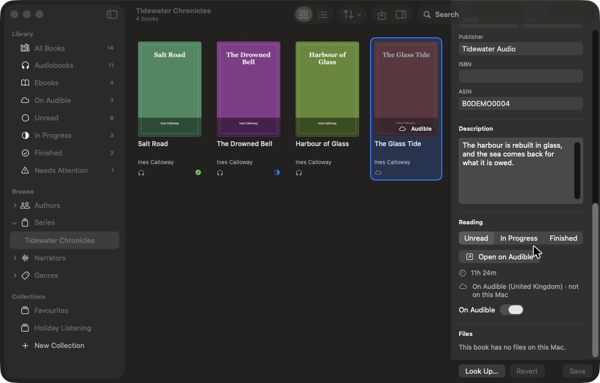
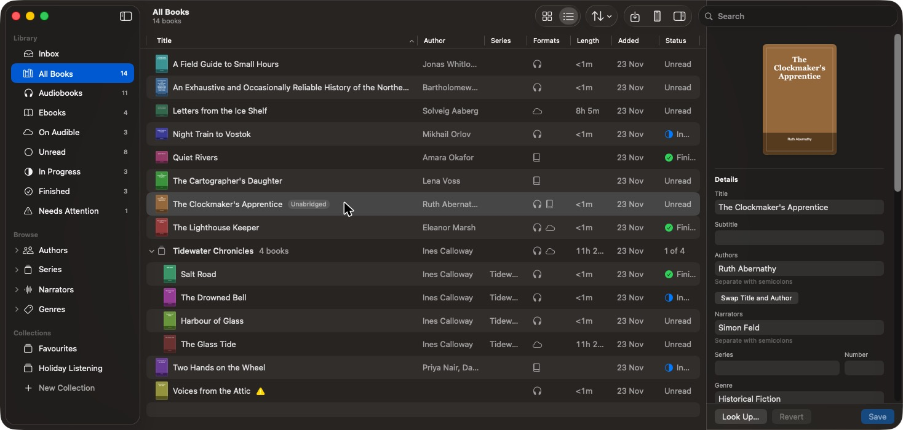

# VoxCarrel

A native Mac app for managing a personal library of audiobooks and ebooks: a modern replacement for Calibre that treats audiobooks and ebooks as equals, with one entry per book whatever forms you own it in.

VoxCarrel files your books into a tidy folder layout, writes details and covers into the files themselves, and looks books up online. It manages files you already own; it is not a store or a downloader.

**Status:** early. It is tested mostly on generated sample books and has had only light use on real collections. Import by copy until you trust it with yours.


| | |
|---|---|
|  |  |
| A series shown in order: three books on this Mac, the fourth on Audible. | The same library as a sortable list. |


The books in these pictures are generated samples from the demo library.

## What it does

- Imports audiobooks (M4B, M4A, MP3, including a folder of parts as one book) and ebooks (EPUB, PDF; MOBI and AZW3 are filed but never modified), by move or copy, through a review sheet.
- Keeps an audiobook, its ebook and companion files together as one book, in `Author/Series/Title` folders.
- Edits details and covers for one book or many, written into the files and checked before they replace the originals.
- Looks books up on Open Library, the Audible catalogue (several countries' stores at once) and, if you turn it on, the Library of Congress, which knows many older cassette and CD editions. Results that are your exact edition are marked, as are different editions; you choose which fields to take, from one result or several, and applying them saves in one step.
- Works out whether an audiobook is unabridged, abridged or a dramatisation, from its title and file names, from a matching catalogue entry, or from its running time.
- Tracks books you own on Audible alongside your local files, so a series shows complete.
- Measures the true length of MP3s whose header states the wrong one, and can repair those headers so the files play in full everywhere.
- Read status, tags, ratings and collections; undo for the last operation; a check of the library at launch.

## What it does not do

- It does not play or read books; opening one hands it to your usual player or reader.
- It does not handle protected files such as Audible downloads (`.aax`, `.aaxc`). Books you own on Audible can be listed alongside your files instead.
- It does not sign in to any account or download books.

## Requirements

macOS 15 or later. Building needs the Swift 6 toolchain (Xcode 16 or later). There is no Xcode project; Xcode can open either `Package.swift` directly.

## Layout

- `VoxCarrelCore/` — the engine: scanning, filing, tags, the catalogue database, online lookup. No user interface.
- `VoxCarrelApp/` — the app: `VoxCarrelAppCore` holds everything the window shows and does (tested without a window); `VoxCarrel` holds the SwiftUI views, which contain no logic.

## Build

```bash
VoxCarrelApp/Scripts/build-app.sh
```

This produces `VoxCarrelApp/build/VoxCarrel.app`, a release build signed for this Mac only. Pass `debug` for a debug build.

## Try it on a demo library

Nothing here touches real books. The demo tool generates sample audiobooks and ebooks. Run these from `VoxCarrelApp/`:

```bash
swift run voxcarrel-demo library ~/VoxCarrelDemo/Library
swift run voxcarrel-demo inbox ~/VoxCarrelDemo/Inbox
open build/VoxCarrel.app --args -libraryPath ~/VoxCarrelDemo/Library
```

- `library <folder>` makes a library of sample books already imported. Add `--count 2000` for a large one.
- `inbox <folder>` makes a folder of loose files to drag onto the window.
- `-libraryPath <folder>` opens that library for this launch without changing the remembered one.

## First run on real books

Create a new, empty folder for the library, outside any synced folder such as iCloud Drive: the catalogue database lives in the library folder and should not be synced while in use. Import a handful of books with "Copy files, leave originals in place" ticked, and check the result before importing more.

Editing a book changes nothing until you press Save. Edit ▸ Undo (⌥⌘Z) reverses the last import, save or repair.

## Tests

```bash
VoxCarrelApp/Scripts/test-all.sh
VoxCarrelApp/Scripts/smoke-launch.sh
```

`test-all.sh` runs both packages' tests as debug and as optimised builds. `smoke-launch.sh` builds the app, opens it on a fresh temporary demo library, checks it stays running, and quits it. Tests never use the network; lookup tests run on recorded answers.

## Online lookup and privacy

Nothing is sent anywhere until you press Look Up (or Check Edition, or search in Add Audible Book). Then the title, author, narrator, ISBN or Audible ID you search for is sent to the sources that are switched on, and cover images are downloaded from Open Library and Audible.

Each source can be switched on or off in Settings ▸ Lookup. A source that is off is never contacted.

- **Open Library** and **Audible** are on by default and use encrypted connections. The Audible catalogue search is an unofficial interface and may change.
- **The Library of Congress** is off by default. Its catalogue search is only offered over an unencrypted connection, so the title, author or ISBN you look up there can be seen on your network. It is the one exception to the app's rule of encrypted connections only.

VoxCarrel does not sign in to any account.

## Support

If VoxCarrel is useful to you, you can support its development:

[](https://ko-fi.com/K7Q12B3BHJ)

## Licence

VoxCarrel is free software, released under the [GNU Affero General Public License, version 3](LICENSE). You may use, study, change and share it; anything built from it must be shared under the same licence, including when it is offered to others over a network.

Copyright © 2026 Gem Global Ventures.
